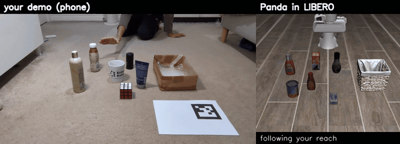
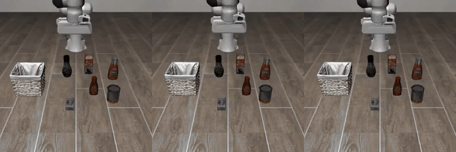
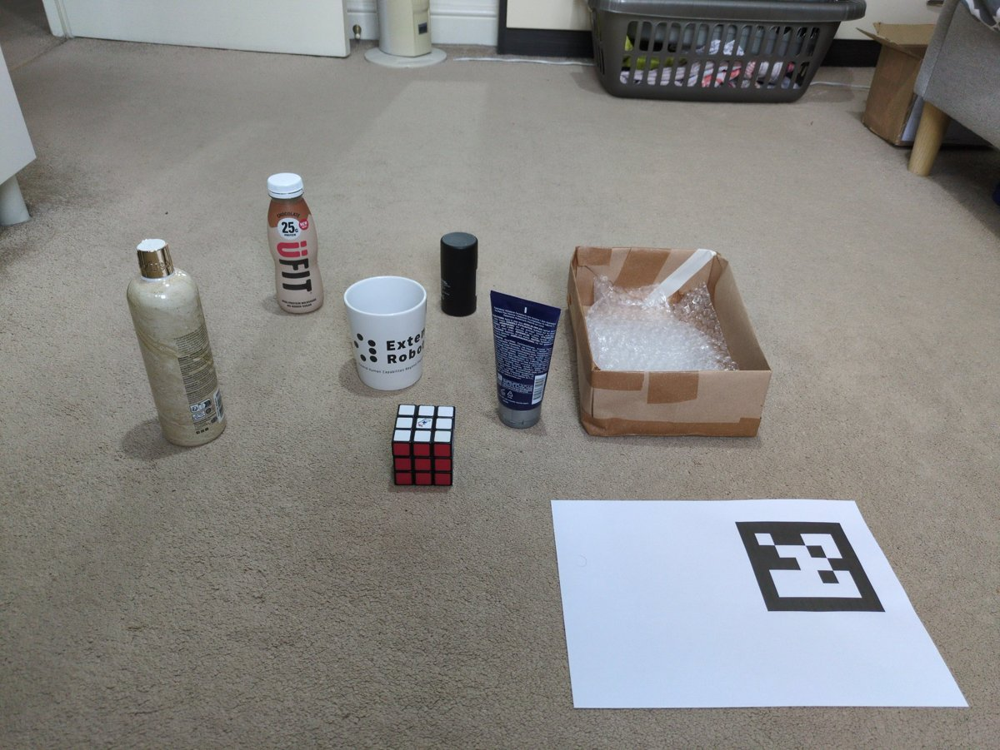
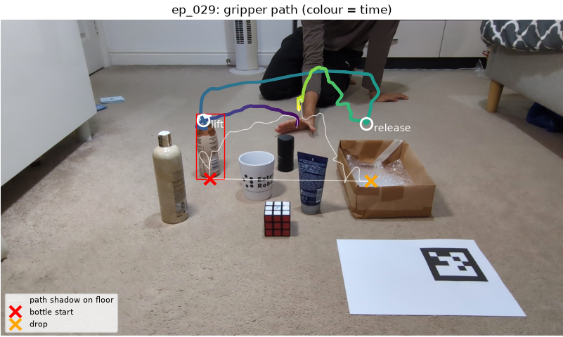
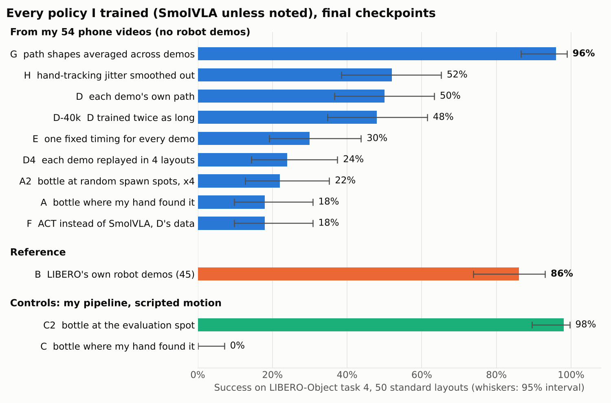
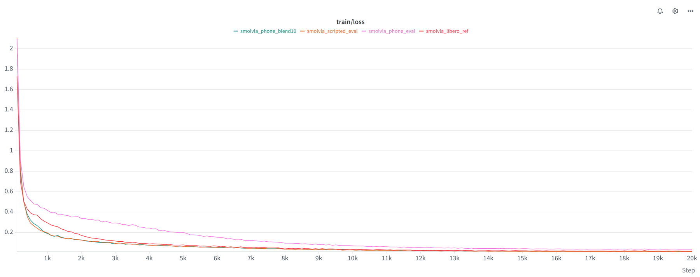
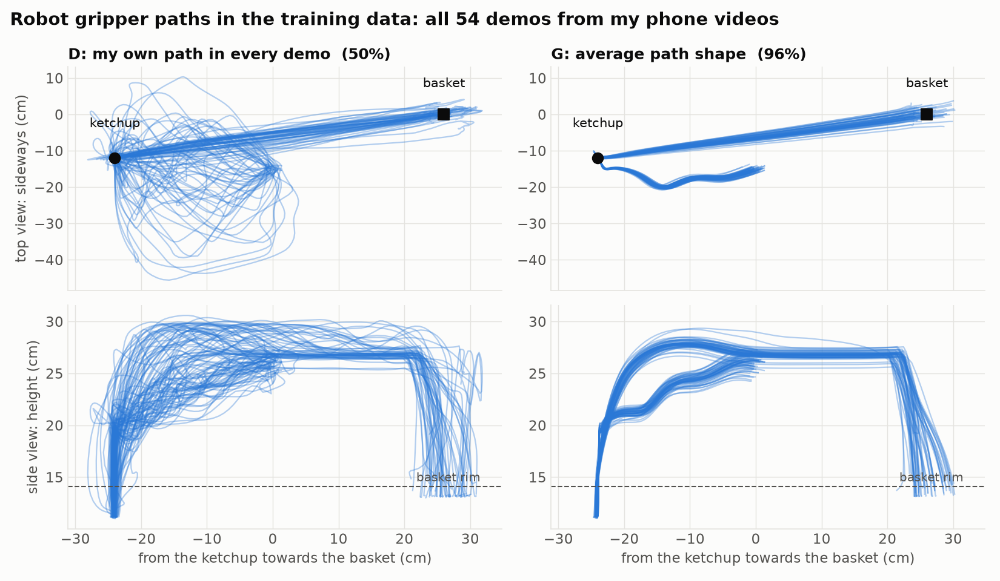
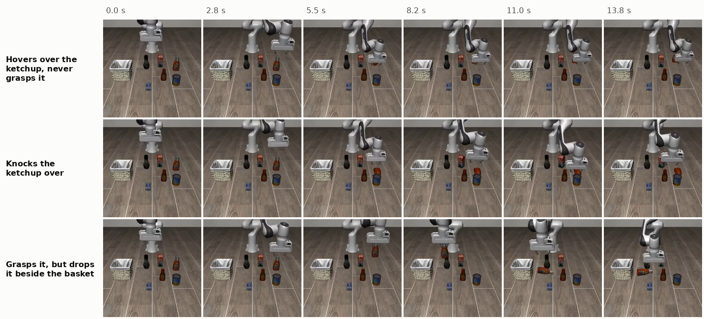

# Real2Sim: teaching a simulated robot from phone videos of my hand

I filmed myself 54 times on a phone, picking up a bottle and dropping it in a box. This repo
turns those videos into robot demonstrations in the LIBERO simulator (LIBERO-Object task 4,
*"pick up the ketchup and place it in the basket"*), fine-tunes the SmolVLA vision-language-action
model on them, and evaluates it the standard LIBERO way, on the task's 50 starting layouts.



*Left: one of my phone demos. Right: the Panda replaying it after retargeting. Replays like this,
recorded from the robot's cameras, are the training data.*

| Training data (SmolVLA, 20k steps) | Robot demos used | Success (50 layouts) |
|---|---|---|
| **G: my 54 phone demos, path shapes averaged across demos** | **0** | **96%** (48/50) |
| D: my 54 phone demos, each with its own path | 0 | 50% (25/50) |
| B: LIBERO's own robot demos of the same task (reference) | 45 | 86% (43/50) |



*The trained policy (run G) in three of the evaluation layouts, real time. It never saw a robot demo.*

The policy learns the task from my videos alone. Using each demo's raw hand path gives 50%;
averaging the shape of the 54 paths gives 96%, above the policy trained on LIBERO's own robot
demos. Getting there took 12 training runs, including control experiments that showed *why* the
first versions only reached ~20%. A short slide deck with the same story is in
[docs/presentation.pdf](docs/presentation.pdf) (editable: `docs/presentation.pptx`).

---

## How it works



*The setup: a protein-shake bottle stands in for the ketchup, a cardboard box for the basket,
other objects are distractors. The printed ArUco marker (100 mm) gives the scale and the floor.*

```
phone video ─► hand + bottle tracking ─► 3-D gripper path ─► retarget onto the Panda
  54 clips     MediaPipe, ArUco, A4 sheet   metres, floor frame    LIBERO coordinates
                                                                         │
 evaluate on LIBERO's 50 layouts ◄── fine-tune SmolVLA ◄── LeRobot dataset ◄── replay in LIBERO,
                                                                              record cameras + actions
```

**1. Recording.** Phone on a fixed stand, 30 fps, 54 demos in four long recordings,
cut into one clip each with `data/clips.csv` (`src/cut_clips.py`).

**2. Extraction** (`src/extract_trajectory.py`, CPU, ~40 s per clip).
- Camera: the focal length is estimated from the edges of the A4 sheet the marker is printed on,
  and the camera pose from the marker.
- Bottle: its start and drop points come from the difference between the first and last frames;
  a template tracker finds the moment of lift-off.
- Hand: MediaPipe hand landmarks; the grasp point is the thumb-index midpoint. Detections that
  don't move (my other hand, a foot) are thrown away.
- Depth from one camera is the hard part. During the carry the hand's camera ray is intersected
  with the vertical plane through the bottle's start and drop points, which is purely geometric.
  For the reach, MediaPipe's metric hand model gives depth by PnP, rescaled to meet the carry
  exactly at lift-off.
- Output per clip: a time-stamped 3-D path, gripper open/closed, and a debug image.
  51/54 clips were clean; the other 3 were grasped by the neck and kept.



*One demo after extraction: tracked grasp point (colour = time), its shadow on the floor, where
the bottle started and where it was dropped.*

**3. Retargeting** (`src/replay_in_sim.py`).
- One similarity transform (scale 1.20, rotation −16.8°) maps my floor onto the table, fitted so
  the average grasp lands on the ketchup and the average release in the basket.
- Heights are rescaled: my bottle is 19 cm, the sim ketchup 14.6 cm, the basket rim 14.1 cm.
- The robot follows my hand for the reach and the carry (70% of all control steps). Short
  robot-side steps do what a phone can't measure precisely: line up above the ketchup, descend,
  close, wait to be over the basket, open, lift away.
- The arm is driven with LIBERO's own controller and action space (7-D delta end-effector, 20 Hz),
  so a replay is exactly the kind of data a LIBERO policy is trained on. 54/54 replays succeed.

**4. Dataset** (`src/make_dataset.py`). Every replay is recorded with both robot cameras in the
format of LeRobot's LIBERO data (`lerobot/libero`): two 256×256 images, 8-D state, 7-D action,
the task sentence. The same training and evaluation commands therefore work for my data and for
LIBERO's.

**5. Training and evaluation** (`setup/run_experiment.sh`, `setup/evaluate.sh`). SmolVLA
(`lerobot/smolvla_base`) is fine-tuned with the same settings in every run (batch 32, 20k steps,
seed 1000) and evaluated with `lerobot-eval` on the 50 standard layouts of the task.

---

## Results



| Run | Training data (54 demos unless noted) | 10k steps | 20k steps (final) |
|---|---|---|---|
| **B** | LIBERO's own robot demos (45), reference | 70% | **86%** (74–93%) |
| A | my motion, bottle where my hand found it | 22% | 18% (10–31%) |
| A2 | my motion, bottle at random points of LIBERO's spawn area, ×4 (216) | 22% | 22% (13–35%) |
| C | scripted motion, bottle where my hand found it (control) | 0% | 0% (0–7%) |
| C2 | scripted motion, bottle at the evaluation spot, 50 layouts (control) | 88% | **98%** (90–100%) |
| D | my motion, bottle at the evaluation spot, 50 layouts | 20% | **50%** (37–63%) |
| D4 | D, each demo replayed in 4 layouts (216) | 16% | 24% (14–37%) |
| D-40k | D, trained for 40k steps | 10%\* | 48% (35–61%) |
| E | D with one fixed, smooth timing for every demo | 20% | 30% (19–44%) |
| F | D's data, ACT instead of SmolVLA (30k steps) | 20% | 18% (10–31%) |
| **G** | **D with the path shapes averaged across demos** | **96%** | **96%** (87–99%) |
| H | D with hand-tracking jitter filtered out | 24% | 52% (39–65%) |

Brackets are 95% Wilson intervals over 50 episodes. \*D-40k's learning rate decays more slowly,
so its 10k checkpoint isn't comparable. Raw numbers: [outputs/eval/results.md](outputs/eval/results.md)
and the `eval_info.json` files next to it. "Scripted motion" (C, C2) swaps my reach and carry for
straight minimum-jerk moves and keeps everything else from each demo.



*Training loss in Weights & Biases for B (`smolvla_libero_ref`), C2 (`smolvla_scripted_eval`),
D (`smolvla_phone_eval`) and G (`smolvla_phone_blend10`). G and C2 fit as fast as LIBERO's own demos;
D's loss stays highest the whole way, because its 54 different paths are harder to fit. That is the
same problem the results below point to.*

### What the results mean

1. **The pipeline itself works.** With idealised motion (C2) it produces data that trains SmolVLA
   to 98%, above LIBERO's own demos. That ruled out a bug in retargeting, action labels or format.
2. **Where the bottle is mattered first.** In all 50 evaluation layouts the ketchup is at exactly
   the same spot, and LIBERO's demos have it there too. My first datasets put it wherever my hand
   found the bottle (typically 3 cm away, up to 13 cm), so the policy had to find a narrow bottle by
   sight from 54 examples and knocked it over. Moving it to the evaluation spot: C 0% → C2 98%,
   A 18% → D 50%.
3. **What was left was the variation between my paths.** D and C2 differ only in the motion. Three
   runs narrowed down which part of the motion hurts:
   - E: same paths, one fixed timing → 30%. Timing is not the problem (if anything my own speed,
     slowing down near the bottle, helps).
   - H: tracking jitter (~6 mm during the reach) filtered out → 52%. Measurement noise is not it.
   - D-40k: twice the training → 48%. Not under-training either.
4. **Averaging the path shapes fixes it (G, 96%).** Each path is split into the straight line from
   its start to its end plus how it bends away from that line. The bends are averaged over normalised
   time and put back on each demo's own line. Every demo keeps its own start, grasp, release and
   duration, and the shape is still made of my motion; it is just consistent now.
5. **More copies of the same motions don't help** (A2, D4), and **the pretrained VLA matters**:
   ACT trained from scratch on D's data got 18% against SmolVLA's 50%.



*The robot's gripper paths in the training data. Left: D, each demo follows my own hand path.
Right: G, every demo has the average shape but its own start, end and timing.*

**Failures.** From the first 10 evaluation videos of each run: D hovers over the ketchup (3),
knocks it over (2), or drops it beside the basket or runs out of time (2). The scripted control C,
with the bottle in the wrong place, mostly hovered (7/10).



**Side test: re-planning more often.** SmolVLA predicts 50 actions and normally plays them all
(2.5 s) before looking again. Re-planning D every 10 or 5 steps gave 58% and 42%, within the
noise of 50 episodes, so every run uses the default.

---

## Design choices

- **Phone + printed marker, no depth camera.** Anyone can record this. The marker fixes scale
  and the floor plane; the A4 sheet around it calibrates the focal length, so no calibration step.
- **Geometry over learned depth where possible.** Single-image hand depth was off by up to 40%
  during the carry. The carry stays near the vertical plane between the bottle's start and the
  box, so intersecting the hand's ray with that plane gives a reliable 3-D path.
- **Human motion for the big movements, robot-side steps for contact.** A phone can't tell how
  the fingers close on the bottle, and copying the hand's grasp made the ketchup slip. The robot
  follows my reach and carry and does the last few centimetres itself.
- **Use the benchmark's own action space and data format.** Replays go through LIBERO's own
  controller, and the dataset matches `lerobot/libero` exactly, so the comparison with LIBERO's
  demos (B) uses identical training and evaluation code.
- **SmolVLA** is small enough (~450M parameters) to fine-tune on a single 16 GB GPU in ~75 min,
  and is pretrained, which matters with 54 demos (run F).
- **Controls and one change per run.** Each run changes one thing relative to another, so a
  difference in success has one explanation. The scripted controls (C, C2) were what turned
  "it gets ~20%" into a diagnosis.

## What worked and what didn't

| Worked | Didn't work |
|---|---|
| Hand-ray / carry-plane intersection for depth | Marker-based hand depth during the carry (up to 40% off) |
| Fitting the floor → sim transform on where the **hand** released | Fitting it on where the bottle came to rest (tipped ~6 cm further, releases hit the rim) |
| Robot lines up above the ketchup and descends vertically | Following the path directly: the arm lagged 4–7 cm and knocked the bottle over |
| Grasp height mapped into a tested 8.5–10.5 cm band | Copying the hand's grasp height (neck grasps slipped) |
| Bottle at the exact evaluation spot (A → D) | Bottle anywhere in the spawn area (A2), more copies of the same demos (D4) |
| Averaging the path shapes (D → G, 96%) | Uniform timing (E), smoothing jitter (H), longer training (D-40k), ACT (F) |

One thing I got wrong on the way: I first blamed C's 0% on the slow approach above the bottle in
the scripted motion. C2 has the same approach and scores 98%; C hovered because it never knew where
the bottle would be.

## Limitations, and what I'd do with more time

- **One task, one seed per run, 50 episodes.** Differences under ~15 points are within noise.
  With more compute: 3 seeds per run, and the same pipeline on other LIBERO tasks.
- **The benchmark is narrow.** The ketchup is always in the same place, which is why averaging the
  paths works so well. To generalise to new positions I would record more demos with the bottle
  moved around and blend only part-way towards the average, or average only demos that start and
  end close to each other.
- **The grasp is partly scripted.** About 30% of each episode is robot-side steps. A 3-D hand-mesh
  model (HaMeR, WiLoR) or a second camera would give finger contact and better depth, so the gripper
  could follow the hand directly.
- **RL fine-tuning.** G is a good starting policy for reinforcement learning in LIBERO (e.g. PPO or
  residual RL on top of the VLA), which could fix the last few percent and recover from mistakes.
- **World models.** The core problem here was too few, too inconsistent demos. An action-conditioned
  video model trained on my clips could generate many more consistent demos, or act as a learned
  simulator to check a policy before running it.
- **Speed.** Evaluating 50 episodes takes under a minute on the GPU, but a real robot needs low
  latency per action chunk: I would profile and quantise SmolVLA and compare chunk sizes.

---

## Datasets and models

Everything in the results table can be rebuilt from `data/trajectories/` (in this repo) with one
command per run (see below). The main artefacts are also on the Hugging Face Hub:

| What | Where | Size |
|---|---|---|
| 54 phone clips (input) | [datasets/yjoshi5379/real2sim-ketchup-phone-clips](https://huggingface.co/datasets/yjoshi5379/real2sim-ketchup-phone-clips) | 54 mp4 clips, 30 fps |
| Extracted 3-D trajectories | `data/trajectories/ep_001.npz` … `ep_054.npz` (+ `.json`) | 54 files |
| Dataset D (each demo's own path) | [datasets/yjoshi5379/real2sim-ketchup-D](https://huggingface.co/datasets/yjoshi5379/real2sim-ketchup-D) | 54 episodes, 10,285 frames |
| Dataset G (averaged path shape) | [datasets/yjoshi5379/real2sim-ketchup-G](https://huggingface.co/datasets/yjoshi5379/real2sim-ketchup-G) | 54 episodes, 10,042 frames |
| SmolVLA trained on G (96%) | [yjoshi5379/smolvla-real2sim-ketchup-G](https://huggingface.co/yjoshi5379/smolvla-real2sim-ketchup-G) | |
| SmolVLA trained on D (50%) | [yjoshi5379/smolvla-real2sim-ketchup-D](https://huggingface.co/yjoshi5379/smolvla-real2sim-ketchup-D) | |

Local names when you rebuild them: run *X* writes `data/lerobot/ketchup_<name>/`,
`outputs/train/<run>/` and `outputs/eval/<run>_<checkpoint>/`, with these names:

| Run | Dataset folder | Train / eval name | `make_dataset.py` options |
|---|---|---|---|
| A | `ketchup_phone` | `smolvla_phone` | `--placement human` |
| A2 | `ketchup_phone_spawn4` | `smolvla_phone_spawn4` | `--placement spawn --augment 3` |
| B | (LIBERO's `lerobot/libero`, 45 episodes) | `smolvla_libero_ref` | n/a |
| C | `ketchup_scripted` | `smolvla_scripted` | `--motion scripted --placement human` |
| C2 | `ketchup_scripted_eval` | `smolvla_scripted_eval` | `--motion scripted --placement eval --init-state all` |
| D | `ketchup_phone_eval` | `smolvla_phone_eval` | `--placement eval --init-state all` |
| D4 | `ketchup_phone_eval4` | `smolvla_phone_eval4` | `--placement eval --init-state all --augment 3` |
| D-40k | `ketchup_phone_eval` | `smolvla_phone_eval_40k` | as D |
| E | `ketchup_phone_timed` | `smolvla_phone_timed` | `--motion timed --placement eval --init-state all` |
| F | `ketchup_phone_eval` | `act_phone_eval` | as D |
| G | `ketchup_phone_blend10` | `smolvla_phone_blend10` | `--placement eval --init-state all --blend 1.0` |
| H | `ketchup_phone_smooth` | `smolvla_phone_smooth` | `--placement eval --init-state all --smooth 0.75` |

---

## Running it

### What runs where

| Step | Needs | Linux | Windows | macOS |
|---|---|---|---|---|
| Cut clips, extract trajectories | CPU | ✓ | ✓ in WSL2 | ✓ |
| Replay in the simulator, build datasets | CPU (LIBERO) | ✓ | ✓ in WSL2 | ✗ (use Linux or a cloud machine) |
| Train | NVIDIA GPU (my runs used ~5 GB of its memory) | ✓ | ✓ in WSL2 (CUDA on WSL, not tested by me) | slow on Apple GPU (`DEVICE=mps`) |
| Evaluate | LIBERO; GPU recommended | ✓ | ✓ in WSL2 | ✗ |

What I used: a Windows laptop without a GPU (WSL2, Ubuntu 22.04) for recording, extraction and
replays, and a Linux workstation with an RTX 4070 Ti SUPER (16 GB) for training and evaluation.
Any Linux cloud GPU (e.g. RunPod) works the same way. LIBERO's package only installs on Linux,
which is why the simulator steps need Linux or WSL2.

### 1. Install

**Linux** (Ubuntu 22.04 tested): install [Miniconda](https://www.anaconda.com/docs/getting-started/miniconda/install) and git, then

```bash
git clone https://github.com/yash-joshi5379/Real2Sim-Task.git
cd Real2Sim-Task
bash setup/install.sh          # 15-30 min; creates the conda env "real2sim"
conda activate real2sim
```

`install.sh` installs the OpenGL libraries with `apt-get` (needs sudo; on a shared machine without
sudo run `SKIP_APT=1 bash setup/install.sh`), PyTorch (CUDA 12.8 build if `nvidia-smi` is found,
CPU build otherwise), LeRobot pinned to the commit I used (`setup/lerobot_commit.txt`) with the
exact package versions of my runs (`setup/requirements-lock.txt`), and checks that the simulator
renders.

**Windows**: open PowerShell as administrator, run `wsl --install -d Ubuntu-22.04`, restart, open
"Ubuntu", then follow the Linux steps inside it. Keep the repo inside the Linux file system
(`~/Real2Sim-Task`, not `/mnt/c/...`) or file access is very slow. The simulator renders on the
CPU there (OSMesa, chosen automatically). For GPU training in WSL2, install the normal NVIDIA
Windows driver; CUDA then works inside WSL2.

**macOS**: install Miniconda (Apple Silicon or Intel) and run the same `bash setup/install.sh`.
It installs everything except LIBERO, so steps "Cut" and "Extract" below work; for the simulator,
training and evaluation use a Linux machine.

### 2. Quick check, no GPU and no videos needed

```bash
python src/replay_in_sim.py                               # all 54 demos, ~15 min: "54/54 replays ..."
python src/replay_in_sim.py --episodes ep_029 --video     # -> data/sim_replays/ep_029.mp4
python src/make_dataset.py --placement eval --init-state all --blend 1.0 --dry-run   # run G's data
```

Each replay takes ~15 s on a laptop CPU.

### 3. Reproduce a row of the results table

```bash
bash setup/run_experiment.sh G       # any of: A A2 B C C2 D D4 D40k E F G H
python src/results.py                # rebuilds outputs/eval/results.md and docs/media/results.png
```

This builds the dataset (15–30 min), trains (~75 min on an RTX 4070 Ti SUPER) and evaluates the
10k and final checkpoints (~2 min each). `STEPS=2000` gives a quick smoke test, `WANDB=1` logs
loss curves to Weights & Biases (`wandb login` first). Run it inside `tmux` on a remote machine.
If `outputs/train/<run>` already exists, delete it or `lerobot-train` refuses to start.

To evaluate the published model without training:

```bash
MODEL=yjoshi5379/smolvla-real2sim-ketchup-G bash setup/evaluate.sh G_from_hub
```

### 4. From your own videos

1. **Print the marker**: an ArUco marker from the 5×5 dictionary, id 68, on A4 paper, with the
   black square measuring exactly 100 mm:
   ```bash
   python -c "import cv2; cv2.imwrite('marker68.png', cv2.aruco.generateImageMarker(cv2.aruco.getPredefinedDictionary(cv2.aruco.DICT_5X5_1000), 68, 1181))"
   ```
   Print `marker68.png` at 100 mm wide (1181 px at 300 dpi) and measure it.
2. **Record**: phone fixed on a stand, landscape, 4K 30 fps, marker sheet flat and fully in view,
   layout as in the photo above (bottle on the left, box 30–80 cm to its right). For each demo,
   reach, pick up the bottle, put it in the box, and take your hand away. Put the bottle back
   between demos; it's fine to record many demos in one long video.
3. **Cut**: put the long videos in `data/raw/`, write the start and end of each demo in
   `data/clips.csv` (format at the top of `src/cut_clips.py`), then
   `python src/cut_clips.py` → `data/clips/ep_001.mp4 …`
4. **Extract**: `python src/extract_trajectory.py` → `data/trajectories/` (look at the
   `*_debug.png` images and `summary.csv`; clips marked `check` are worth a look).
5. **Replay and look**: `python src/replay_in_sim.py`, then
   `python src/side_by_side.py --episodes ep_001` for a video like the one at the top.
6. **Train and evaluate**: `bash setup/run_experiment.sh G`.

My clips can be downloaded to try steps 4 and 5:
`hf download yjoshi5379/real2sim-ketchup-phone-clips --repo-type dataset --local-dir data/clips`

### Troubleshooting

- **Simulator doesn't render** (`check_render.py` fails, EGL errors): set the renderer by hand,
  `export MUJOCO_GL=osmesa PYOPENGL_PLATFORM=osmesa` (CPU, always works) or `MUJOCO_GL=egl` on a
  machine with an NVIDIA GPU. `EGLError ... eglDestroyContext` messages when a script *exits* are
  harmless.
- **LIBERO asks a question on first import**: answer `N` (keeps its default paths); `install.sh`
  does this for you.
- **Small home directory** (shared machines): point the caches to a larger disk before installing,
  e.g. `export HF_HOME=/big/disk/hf PIP_CACHE_DIR=/big/disk/pip`.
- **`torch.load` error about `weights_only`** when loading LIBERO's starting layouts: use the code
  in this repo (`load_init_states` in `src/replay_in_sim.py` handles torch ≥ 2.6).

---

## Repository layout

```
src/cut_clips.py           long recordings -> one clip per demo (ffmpeg)
src/extract_trajectory.py  clip -> 3-D gripper path + gripper signal (ArUco, MediaPipe)
src/replay_in_sim.py       retarget a path onto the Panda and replay it in LIBERO
src/side_by_side.py        my demo | robot replay video
src/make_dataset.py        replays -> LeRobot dataset (all the options behind runs A-H)
src/reference_episodes.py  finds LIBERO's own demos of the task in lerobot/libero (run B)
src/results.py             evaluation results -> table + chart
src/plot_paths.py          the D vs G path figure
setup/install.sh           environment (Linux, WSL2, macOS)
setup/run_experiment.sh    dataset -> training -> evaluation for one run
setup/evaluate.sh          lerobot-eval on the 50 layouts
setup/publish_hf.sh        uploads clips, datasets and models to the Hugging Face Hub
data/clips.csv             start and end of each demo in my recordings
data/trajectories/         the 54 extracted trajectories
outputs/eval/              evaluation results of every run (eval_info.json)
docs/                      figures and the slide deck
```
